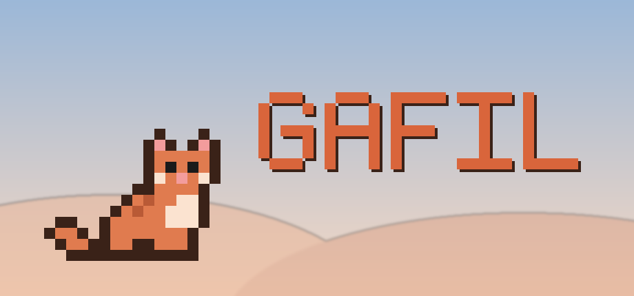
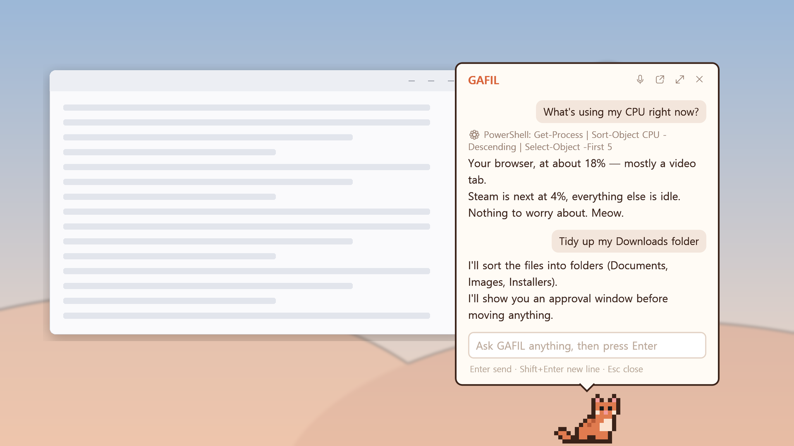
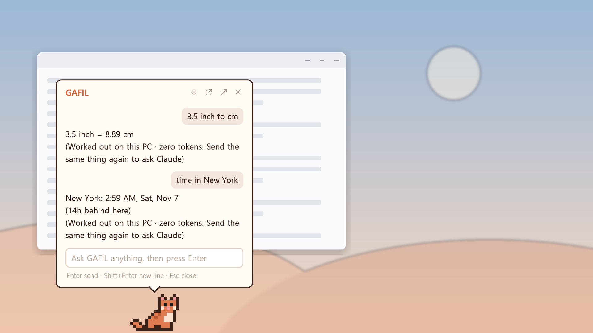
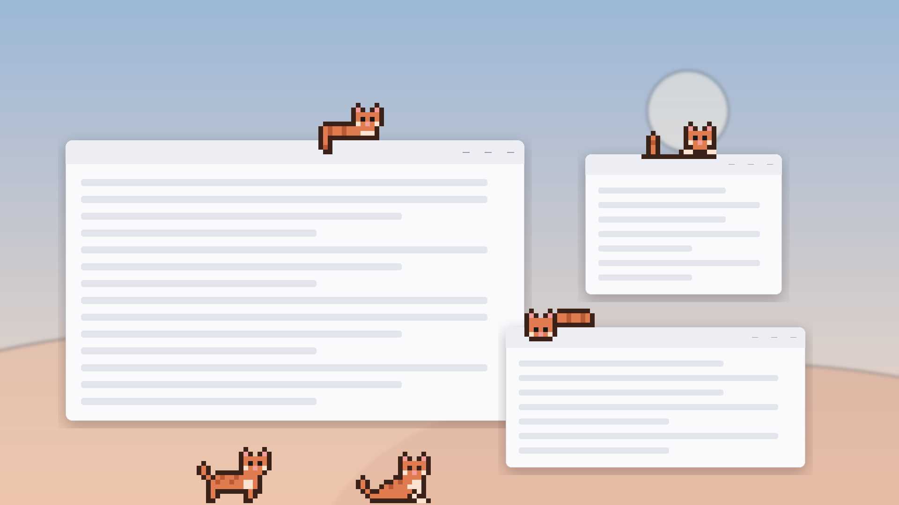
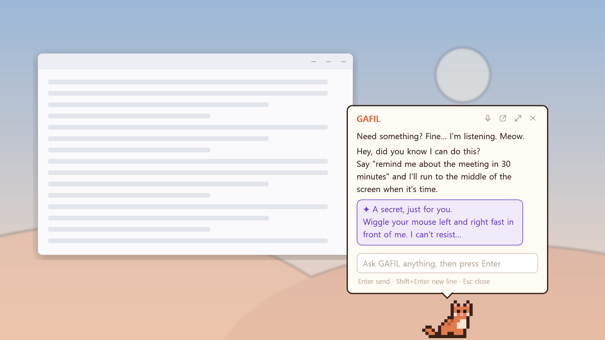
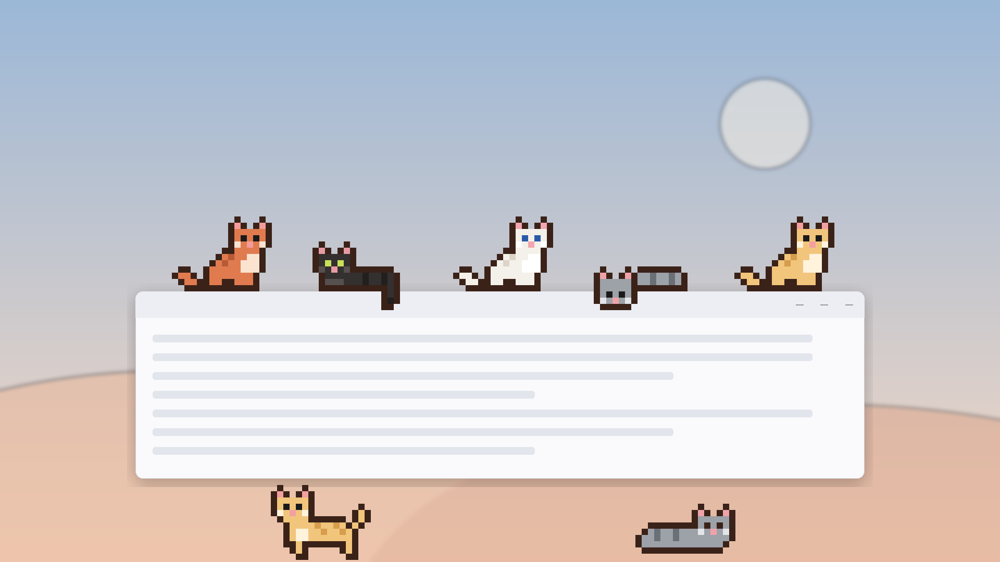
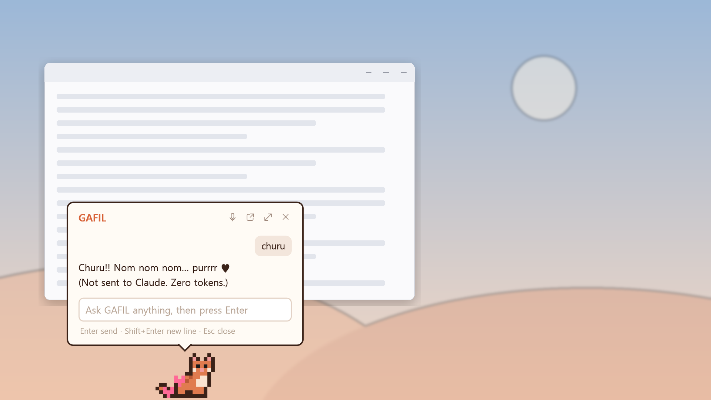

# GAFIL — a pixel cat on your desktop × Claude

<p align="center"></p>

[한국어](README.md) | **English**


**GAFIL** (Genius Autonomous Feline Intelligence & Laziness) is an orange pixel cat that wanders along the bottom of your Windows desktop.
Click it to talk and **Claude** answers. With your permission it can also run commands, work with files and even **operate your screen** for you.

> Unofficial fan project — not affiliated with or endorsed by Anthropic.

---

## A quick look

<table>
<tr>
<td width="50%" align="center"><br><sub>Talk to it and Claude answers; commands run only after you approve</sub></td>
<td width="50%" align="center"><br><sub>Simple math answered right on your PC (zero tokens)</sub></td>
</tr>
<tr>
<td width="50%" align="center"><br><sub>Climbs onto your windows to lounge or tuck itself in</sub></td>
<td width="50%" align="center"><br><sub>Introduces what it can do as you get closer</sub></td>
</tr>
<tr>
<td width="50%" align="center"><br><sub>5 fur colors, 4 outfits</sub></td>
<td width="50%" align="center"><br><sub>Give it churu (zero tokens)</sub></td>
</tr>
</table>

---

## What it does

| Feature | Description |
|---|---|
| 💬 Chat | Click the cat → ask in the speech bubble → Claude's answer types itself out. Keeps the conversation context |
| 📈 CPU/GPU | When you're not chatting, shows `CPU 12% · GPU 3% 45°C` above the cat. NVIDIA GPUs also show temperature and VRAM; integrated GPUs show usage |
| ⚙ Commands & files | "Close my browser", "Tidy up my Downloads folder", … **An approval window before every run** |
| 🐾 Screen control | Tasks that need the screen, like "Search the weather in my browser". It looks at screenshots and clicks/types. **Works across multiple monitors**. **One approval per task + red border + emergency stop** |
| ↗ Hand off to the Claude app | Double-click the bubble header → a new chat in the Claude desktop app, pre-filled with the conversation |
| 🔁 Starts with Windows | Appears automatically when you sign in (can be turned off in the menu) |
| ⌨ Summon hotkey | `Ctrl+Alt+G` from anywhere → the bubble opens, ready to type |
| 🎤 Talk to it | 🎤 button or `Ctrl+Alt+Space` → speak; it writes down what you say and sends it when you pause (Windows voice typing) |
| 🖐 Pick it up | Drag the cat and it dangles **like a kitten carried by the scruff of its neck**. Drop it on another monitor and it lives there |
| 📎 Drop files & text | Drag a file or selected text onto the cat and say "summarize this" (only that file becomes readable without approval) |
| ⏰ Reminders | "Remind me about the meeting in 30 minutes" → when it's time, the cat runs to the middle of the screen to tell you (remembered across restarts) |
| 😺 Moods | Pants when the CPU is busy, sweats when the GPU is hot, and at night it moves slowly and naps with Zz |
| 🎨 Dress up | Right-click → **Change look**: 5 fur colors, 4 outfits |
| 💾 History | Conversation and context carry over after a restart |
| 🪟 Climbs onto windows | Now and then it **jumps onto the top edge** of an open window to walk, loaf with its tail hanging, or peek down. Too high? It hops up via lower windows or **climbs the window's side**. Move the window and it rides along; close it and the cat drops (it never looks at window contents; can be turned off in the menu) |
| 🙀 Body-language alerts | When an **error/warning dialog** pops up the cat leaps onto it and shows `!`; when an app is **not responding** it taps on that window; after **90 minutes** without a break it lies belly-up mid-screen. Click the cat to see what's up. **Zero tokens**: no screenshots, no Claude calls. For dialogs it only pre-fills "What does this mean?" in the input; nothing is sent until you press Enter |
| 🧮 Quick answers | Simple things like `3.5 in to cm`, `15% of 48000`, `time in New York`, `days until 12/25`, `100 days from now` are **answered on your PC without asking Claude** (**zero tokens**). Send the same thing again to ask Claude instead (turn off in the menu) |
| 📦 Cat things | When a small window pops up the cat climbs on and **sits in it like a box**, **grooms** after being carried, and **kneads** when the bubble has been open and quiet for a while |
| 💡 Skill intros | Everything is on from day one. As you spend time together, the cat opens with **"Hey, did you know I can do this?"** and introduces one feature at a time (at most one every 3 hours). Once you're close, it **very rarely (0.01% per minute)** whispers how to trigger a hidden easter egg, in **purple**. Closeness only grows from time together, opening the bubble and churu (asking Claude doesn't count). Turn off in the menu |
| 🐱 Meow | **Now and then** it meows: when a reminder fires, when a reply arrives while the bubble is closed, when you put it down (about once per 10 minutes; can be turned off in the menu) |
| 🌐 Korean / English | Follows your Windows display language (can be fixed in settings) |
| ⬆ Update notice | The cat tells you when a new version is out, with a one-click download from the menu |


---

## Requirements

- **Windows 11** or **Windows 10 version 2004+** (64-bit)
- **Claude Code** (Anthropic's command-line tool), installed and logged in
  - Either a Claude **Pro / Max subscription** or an **Anthropic API key**
- .NET is **not** required (it's bundled in the exe)

---

## Installation

### 1. Install Claude Code and log in

> **Since v1.9 you can skip this.** If Claude Code is missing or not logged in when GAFIL first starts, a **setup helper** opens and helps you install it, check the connection and paste an API key. For a subscription, log in to Claude Code yourself (below) and GAFIL uses it. Reopen it any time: right-click → **Connect to Claude**.

To do it yourself, in PowerShell:

```powershell
irm https://claude.ai/install.ps1 | iex
```

(If you have Node.js, `npm install -g @anthropic-ai/claude-code` works too.)

Then run it once in a terminal to log in:

```powershell
claude
```

Log in with your Claude account in the browser that opens, then close the terminal with `/exit`.
More: [Claude Code docs](https://docs.claude.com/en/docs/claude-code/overview)

### 2. Get GAFIL

**Option A — download the exe (recommended)**

1. From [Releases](../../releases/latest), download `GAFIL.exe` and `install.cmd` into **the same folder**.
2. Double-click `install.cmd`.
   → It is copied to `%LOCALAPPDATA%\Programs\GAFIL\GAFIL.exe`, started, and registered to start with Windows.

> The exe is not code-signed, so **Windows SmartScreen** may warn you the first time. Click "More info → Run anyway".

**Option B — build from source**

Requires the [.NET 8 SDK](https://dotnet.microsoft.com/download/dotnet/8.0).

```powershell
git clone https://github.com/steeze1213/GAFIL.git
cd GAFIL
dotnet publish -c Release -p:PublishSingleFile=true -p:IncludeNativeLibrariesForSelfExtract=true -p:EnableCompressionInSingleFile=false -o dist
.\install.cmd
```

### 3. Check

- If a cat appears at the bottom right and starts walking, the app works.
- Click the cat → say "hi" → if it answers, the Claude connection works too.
- If you see "Couldn't find the 'claude' command" or a login error, see [Troubleshooting](#troubleshooting).

---

## Accounts

GAFIL uses **whatever account Claude Code on that PC is logged into**. There's no separate account setting.

| To do this | Do this |
|---|---|
| Switch Claude accounts | In a terminal: `claude` → `/logout` → `/login` → right-click GAFIL → **New conversation** |
| Use an API key instead of a subscription | Right-click → **Connect to Claude** → paste the key → **Save key** (stored in the user environment variable `ANTHROPIC_API_KEY`; billed by API usage) |
| (Advanced) Other models or gateways | GAFIL is built for Claude, but it passes Claude Code's environment through. Point `ANTHROPIC_BASE_URL` / `ANTHROPIC_AUTH_TOKEN` at an Anthropic-compatible gateway (corporate proxy, LiteLLM, …) and requests go there. Not officially supported; models without tool use can't run commands or control the screen |
| Pin a model | Set `"Model"` in the settings file to `"sonnet"`, `"opus"`, `"haiku"`, … → restart GAFIL. Empty = Claude Code's default |

> Logins, settings and logs are stored per Windows user account.

---

## Usage

### The cat

- **Left-click**: open/close the speech bubble
- **`Ctrl+Alt+G`** (anywhere): open the bubble and start typing
- **`Ctrl+Alt+Space`** (anywhere) or 🎤 in the bubble: talk. It sends 1.8 s after you stop speaking
- **Drag**: pick it up by the scruff. It drops to the floor where you release it and stays on that monitor
- **Drop files/text**: they appear as 📎 chips above the input box → type what to do, or just press `Enter` (summarize)
- **Right-click**: menu — Talk, New conversation, Change look (fur / outfit), Meow sounds, Climb onto windows, Answer simple math here, Tell me what you can do, Body-language alerts, Show CPU/GPU, Start with Windows, Connect to Claude, Open settings file, Open command log, Quit GAFIL

### The speech bubble

- `Enter` send · `Shift+Enter` new line · `Esc` close
- Header buttons: ■ Stop (while working) · 🎤 Talk · Continue in app · Expand (up to the top of the screen) · Close
- **Double-click** the header or chat history to continue in the Claude desktop app (requires the app)

### Try asking

```
Hi, help me plan my day
Which 5 programs are using the most memory right now?
Close my browser
Open Notepad and type "Hello GAFIL"
Remind me to stretch in 30 minutes
Remind me tomorrow at 9:30 to send the meeting notes
```

---

## Safety

GAFIL is built so that it **doesn't change your PC without your permission**.

| Action | How it's handled |
|---|---|
| Running commands (PowerShell/Bash), writing or editing files | **Approval window every time**, showing exactly what will run/be written. Default button is "Deny"; auto-denied after 5 minutes |
| Reading files | Inside allowed folders: allowed. Outside: approval window (no allowed folders by default) |
| Fetching web pages | Approval window (a URL can carry data out) |
| Web search | Allowed |
| Screen control | **One approval per task (question)**. Red border while working, **`Ctrl+Alt+Shift+F12` stops it instantly**. Asks again next time |
| Clicks during screen control | A **yellow ring is shown for 0.8 s** where it's about to click. If **you move the mouse** during that time or between actions, it stops immediately |
| Dropped files | Only those files/folders can be **read** without approval, for this conversation. Cleared on a new conversation |
| Reminders | Local timers that don't change your PC, so no approval |

- If you deny something, GAFIL doesn't try the same thing again.
- If another program owns the emergency-stop hotkey, screen control won't start at all (there'd be no way to stop it).
- GAFIL is **instructed** to stop and ask right before paying, sending, deleting or entering passwords. That's an instruction to the AI, not a guarantee; the hard safeguards are the approval window, the red border and the emergency stop.
- Claude Code's global auto-allow rules are not used by GAFIL (it uses only its own settings).

---

## Settings file

Right-click → **Open settings file** (`%LOCALAPPDATA%\ClaudeDesk\settings.json`)

```json
{
  "AllowedFolders": ["D:\\Work", "C:\\Users\\me\\Documents\\notes"],
  "ShowStats": true,
  "AutoStart": true,
  "Model": "",
  "Language": "auto",
  "OpenHotkey": "Ctrl+Alt+G",
  "Skin": "orange",
  "Outfit": "none",
  "ScreenPreviewMs": 800,
  "CheckUpdates": true,
  "SaveHistory": true,
  "Meow": true,
  "ClimbWindows": true,
  "QuickAnswers": true,
  "SkillIntros": true,
  "BodyAlerts": true,
  "BreakMinutes": 90,
  "IdleSleepMinutes": 10,
  "VoiceHotkey": "Ctrl+Alt+Space",
  "VoiceAutoSendMs": 1800
}
```

| Key | Meaning |
|---|---|
| `AllowedFolders` | Folders GAFIL may **read** without approval (writing always needs approval) |
| `ShowStats` | CPU/GPU line above the cat |
| `AutoStart` | Start with Windows (applies only when running from the install location) |
| `Model` | Model to use. Empty = Claude Code's default |
| `Language` | `"auto"` (Windows display language), `"ko"`, `"en"` |
| `OpenHotkey` | Hotkey to summon GAFIL, e.g. `"Ctrl+Shift+Space"`. Empty = off |
| `Skin` / `Outfit` | Look (same as the menu) |
| `ScreenPreviewMs` | Click preview time during screen control (ms). `0` = no preview (moving the mouse still stops it) |
| `CheckUpdates` | Check for new versions (once a day) |
| `SaveHistory` | Save the conversation. `false` = don't save and delete the existing history |
| `Meow` | Occasional meows. `false` = quiet (reminders use the Windows notification sound) |
| `ClimbWindows` | Now and then climb onto windows. `false` = stay on the floor |
| `QuickAnswers` | Answer simple math, units, city times and D-days on your PC (zero tokens). `false` = send everything to Claude |
| `SkillIntros` | Introduce features one at a time as you get closer, and very rarely whisper an easter egg. `false` = neither (`Bond`, `IntroducedSkills`, `HintedEggs`, `LastIntroAt` are progress GAFIL keeps) |
| `BodyAlerts` | Body-language alerts (dialogs, frozen apps, breaks). `false` = off |
| `IdleSleepMinutes` | After this many minutes without a question, the Claude process is shut down to free memory (~500 MB). It restarts on the next question and continues the same conversation (a few seconds slower). `0` = never |
| `BreakMinutes` | Minutes of non-stop work before the break reminder. `0` turns only the break reminder off (5+ minutes without input counts as a break) |
| `VoiceHotkey` | Hotkey for talking. Empty = off |
| `VoiceAutoSendMs` | How long to wait after you stop speaking before sending (ms). `0` = no auto-send, press Enter |

Settings are read when GAFIL starts. After saving, restart GAFIL (right-click → **Quit GAFIL** → run `%LOCALAPPDATA%\Programs\GAFIL\GAFIL.exe`).

---

## Privacy & data

- **Sent to Anthropic**: your questions, file contents GAFIL reads, command output, and **screenshots during screen control** (same as using Claude Code).
- **Voice input** uses Windows voice typing (`Win+H`). Speech-to-text is handled by Windows (Microsoft); GAFIL only receives the transcribed text.
- **Stored only on this PC** (`%LOCALAPPDATA%\ClaudeDesk\`):
  - `settings.json` settings
  - `history.json` conversation history (turn off with `SaveHistory: false`, clear with **New conversation**)
  - `reminders.json` reminders
  - `logs\commands.log` approval requests, allow/deny, command results, screen actions (typed text is logged by length only)
- **Update check**: one anonymous request a day to GitHub's public API (`api.github.com`), no personal data (turn off with `CheckUpdates: false`).
- Claude Code itself also stores conversations in `%USERPROFILE%\.claude\projects\`.
- GAFIL has no server of its own and no remote-access feature.

---

## Troubleshooting

| Problem | Fix |
|---|---|
| The cat doesn't appear | Check for `GAFIL.exe` in Task Manager. If it's not there, run `%LOCALAPPDATA%\Programs\GAFIL\GAFIL.exe`. If an error box appears, check `%LOCALAPPDATA%\ClaudeDesk\logs\commands.log` |
| "Couldn't find the 'claude' command" | Check that Claude Code is installed: `claude --version` in a new terminal. If you just installed it, restart GAFIL |
| Login / auth error | Run `claude` in a terminal → log in → New conversation in GAFIL |
| Screen control never starts | Check whether another program uses `Ctrl+Alt+Shift+F12` (GAFIL's log says "단축키 등록 실패" = hotkey registration failed) |
| Clicks land in the wrong place | If you rearranged monitors or changed scaling, ask GAFIL to look at the screen again, or restart it |
| Screen control keeps stopping | Touching the mouse while it works stops it for safety. Take your hand off the mouse while it works |
| `Ctrl+Alt+G` does nothing | Another program may own it → change `OpenHotkey` |
| 🎤 doesn't transcribe | Windows Settings → Time & language → **Speech** / **Typing**: make sure voice typing is enabled. Try pressing `Win+H` yourself |
| Can't click an administrator window | Windows blocks it (UIPI). Please click it yourself |
| SmartScreen warning | "More info → Run anyway" |

---

## Uninstall

1. Right-click GAFIL → uncheck **Start with Windows** → **Quit GAFIL**
2. Delete the folders `%LOCALAPPDATA%\Programs\GAFIL` and `%LOCALAPPDATA%\ClaudeDesk`

---

## Known limitations

- Screen control looks at one monitor at a time (GAFIL switches monitors when it needs to).
- Screen control takes a few seconds per action. Anything doable with a command is much faster that way.
- Reminders only fire while GAFIL is running (missed ones are shown when it starts).
- On integrated GPUs (Intel/AMD) the GPU temperature shows N/A (there's no vendor-neutral way to read it). Usage is shown.

---

## Project structure

| File | Role |
|---|---|
| `MainWindow.xaml(.cs)` | Cat behavior & pixel drawing, speech bubble, menu, screen-control mode |
| `MainWindow.*.cs` | Split by feature: `Drag`, `Drop`, `History`, `Mood`, `Look`, `Reminders`, `Update`, `OpenHotkey`, `Voice`, `Taskbar` (stay clear of the taskbar), `Perch` (climbing onto windows), `Alerts` (body-language alerts), `Eggs` (hidden fun), `Cozy` (box, grooming, kneading), `Quick` (quick answers), `Bond` (closeness and intros), `Setup` (opens the setup helper) |
| `Edition.cs` | Edition switch: default vs API-key-only (`-p:ApiKeyOnly=true`) |
| `SetupWindow.cs` | Setup helper: install Claude Code, subscription login guidance, save an API key, check the connection (`claude auth status`) |
| `QuickAnswer.cs` | Quick-answer math: expressions, percentages, units, city times, D-days (only when it's sure; otherwise it goes to Claude) |
| `CatMeow.cs` | Meow sound synthesized in code (no audio files) |
| `Reminders.cs` | Reminder store + reminder tools (in-process MCP server `gafil_time`) |
| `L.cs` | Korean/English strings |
| `ClaudeClient.cs` | Runs the Claude Code CLI (stream-json), approvals, logging |
| `ScreenTools.cs` | Screen-control tools (in-process MCP server for the CLI) |
| `ScreenInput.cs` | Screen capture, mouse & keyboard input (`SendInput`) |
| `ScreenControlOverlay.cs` | Red border during screen control |
| `ApprovalWindow.xaml(.cs)` | Approval window |
| `SystemStats.cs` | CPU/GPU readings (NVIDIA NVML / Windows performance counters) |
| `AppSettings.cs` | Settings file, autostart, logging |
| `app.manifest` | Per-monitor DPI awareness (accurate mouse coordinates) |
| `install.cmd` | Install script |

Code comments are in Korean.

---

## Changelog

- **v1.9.2** — The setup helper no longer has a subscription login button, just guidance (log in to Claude Code yourself and GAFIL uses it), out of respect for Anthropic's policy
- **v1.9.1** — API-key-only edition build for redistributors (`-p:ApiKeyOnly=true`), third-party notices (THIRD-PARTY-NOTICES.md). The default edition is unchanged
- **v1.9.0** — Setup helper: if Claude Code is missing or not logged in on first start, install it, log in with your subscription or paste an API key with a button each. Reopen from "Connect to Claude" in the menu
- **v1.8.0** — Skill intros: nothing is locked; the cat introduces its features one at a time as you get closer, and once you're close it very rarely whispers an easter egg in purple. Turn off in the menu
- **v1.7.0** — Quick answers: math, percentages, units, city times and D-days are answered on your PC without asking Claude (zero tokens). Cat things: sits in newly opened small windows like a box, grooms after being carried, kneads when things are quiet
- **v1.6.1** — Lighter: after 10 idle minutes the Claude process is shut down to free ~500 MB (the next question resumes the same conversation); the exe is no longer compressed, cutting GAFIL's own memory by ~60–120 MB (download is now ~160 MB)
- **v1.6.0** — Five hidden easter eggs 🥚 (play with it like a real cat to find them; all zero tokens)
- **v1.5.0** — Body-language alerts: sits on error/warning dialogs with `!`, taps frozen windows, lies down after 90 minutes of work. Clicking shows what's up locally (zero tokens); for dialogs the question is only pre-filled and sent when you press Enter
- **v1.4.2** — No more climbing thin air under a floating window: the cat jumps up to grab the window's side first, and skips climbing if the window floats too high
- **v1.4.1** — Clicking the cat high up on a window no longer drops it to the floor; the bubble opens below the cat instead (expanding grows downward)
- **v1.4.0** — The cat now climbs onto windows now and then (direct jump, hopping via lower windows, or climbing a window's side). On top it walks, loafs with its tail hanging, and peeks down; it rides along when the window moves and drops when it closes. 9 new poses (crouch, leap, land, climb, loaf, peek, belly-up)
- **v1.3.2** — Bigger sleeping "Z" (the small one looked like a capital I)
- **v1.3.1** — More natural meow (a short, chirpy "nyang")
- **v1.3.0** — Screen control works on every monitor (picks a monitor, red border on each), the cat hops on top of an auto-hiding taskbar or dock when it pops up, occasional meows
- **v1.2.1** — 🎤 Talk to it (`Ctrl+Alt+Space`, Windows voice typing, auto-send), English README, better display-language detection
- **v1.1.0** — Summon hotkey, pick up by the scruff & multiple monitors, drop files/text, saved history, reminders, moods (panting, sweating, napping), fur colors & outfits, English UI, update notice, click preview + stop when you move the mouse
- **v1.0.0** — First release: chat, CPU/GPU display, commands & files behind approval, screen control, hand-off to the Claude app, start with Windows

---

## License

[MIT License](LICENSE) — free to use, modify and redistribute (keep the copyright notice).

GAFIL's pixel cat was drawn for this project and is not an official Anthropic character.
"Claude" is a trademark of Anthropic; this is an unofficial project not affiliated with Anthropic.
Licenses of bundled components such as the .NET runtime are in [THIRD-PARTY-NOTICES.md](THIRD-PARTY-NOTICES.md).

### Redistributing GAFIL (API-key-only edition)

Anthropic does not allow apps distributed by other developers to offer Claude subscription (claude.ai) login or subscription usage, and asks them to use **API keys** instead ([Agent SDK docs](https://code.claude.com/docs/en/agent-sdk/overview)).
If you redistribute GAFIL (e.g. on Steam), build the **API-key-only edition**:

```powershell
dotnet publish -c Release -p:ApiKeyOnly=true -p:PublishSingleFile=true -p:IncludeNativeLibrariesForSelfExtract=true -p:EnableCompressionInSingleFile=false -o dist-apikey
```

- The setup helper has no subscription login button and only accepts an Anthropic API key.
- Without an API key it won't start Claude, so a subscription login on that PC is never used. (With a key, Claude Code uses the key first.)
- GitHub update notices are off (the store handles updates).
- Don't use the "Claude" / Anthropic names or logos as the app's name or key art; use them only to describe compatibility. Free distribution is recommended.
- Ship `LICENSE` and `THIRD-PARTY-NOTICES.md` alongside it.
- Steam launch kit (store text, art, AI disclosure, upload script) lives in [`steam/`](steam/README.md).
