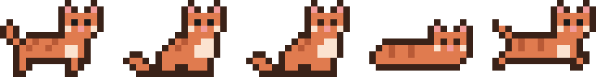
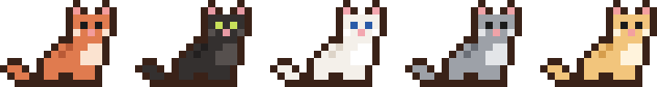
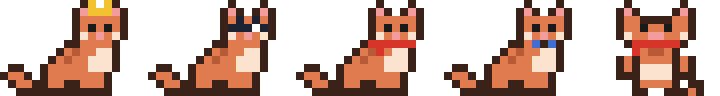

# GAFIL — 바탕화면 픽셀 고양이 × Claude

**한국어** | [English](README.en.md)



**GAFIL** (Genius Autonomous Feline Intelligence & Laziness)은 Windows 바탕화면 아래쪽을 돌아다니는 주황색 픽셀 고양이입니다.
고양이를 클릭해서 말을 걸면 **Claude**가 대답하고, 허락하면 명령 실행·파일 작업·**화면 조작**까지 대신 해 줍니다.

> An orange pixel cat that lives on your Windows desktop and talks to you through Claude (via the Claude Code CLI).
> Unofficial fan project — not affiliated with or endorsed by Anthropic.

---

## 할 수 있는 일

| 기능 | 설명 |
|---|---|
| 💬 대화 | 고양이를 클릭 → 말풍선에 질문 → Claude 답변이 타이핑되듯 표시. 대화 맥락 유지 |
| 📈 CPU/GPU 표시 | 대화하지 않을 때 고양이 위에 `CPU 12% · GPU 3% 45°C`. NVIDIA는 온도·VRAM까지, 내장 GPU는 사용률 |
| ⚙ 명령·파일 작업 | "웨일 닫아줘", "다운로드 폴더 정리해줘" 등. **실행 전마다 승인 창** |
| 🐾 화면 조작 | "웨일에서 날씨 검색해줘"처럼 화면을 봐야 하는 일. 스크린샷을 보고 클릭·입력. **모니터가 여러 개여도 OK**. **작업마다 승인 + 빨간 테두리 + 긴급 정지** |
| ↗ Claude 앱으로 넘기기 | 말풍선 머리줄 더블클릭 → Claude 데스크톱 앱에 대화를 채운 새 채팅 |
| 🔁 자동 실행 | Windows에 로그인하면 저절로 나타남 (메뉴에서 끄기 가능) |
| ⌨ 단축키로 부르기 | 어디서든 `Ctrl+Alt+G` → 말풍선이 열리고 바로 입력 |
| 🎤 말로 하기 | 🎤 버튼이나 `Ctrl+Alt+Space` → 말하면 받아 적고, 말이 멈추면 자동으로 보냄 (Windows 음성 입력) |
| 🖐 집어서 옮기기 | 고양이를 끌면 **목덜미를 물린 아기 고양이처럼** 대롱대롱 매달려 따라옴. 다른 모니터에 놓으면 거기서 돌아다님 |
| 📎 파일·글 끌어다 주기 | 파일이나 선택한 글을 고양이에게 끌어다 놓고 "요약해줘" (그 파일만 승인 없이 읽기 허용) |
| ⏰ 알림 | "30분 뒤에 회의 알려줘" → 시간이 되면 고양이가 화면 가운데로 뛰어와 알려줌 (꺼졌다 켜져도 기억) |
| 😺 기분 | CPU가 바쁘면 헥헥, GPU가 뜨거우면 땀, 밤에는 느릿느릿 자다가 Zz |
| 🎨 꾸미기 | 오른쪽 클릭 → **모습 바꾸기**: 털 색 5가지, 옷·소품 4가지 |
| 💾 대화 기록 | 껐다 켜도 지난 대화와 맥락이 이어짐 |
| 🐱 야옹 | 알림이 울릴 때, 말풍선을 닫아 둔 사이 답이 왔을 때, 내려놓을 때 **가끔** 야옹 (10분에 한 번 정도. 메뉴에서 끄기) |
| 🌐 한국어 / English | Windows 표시 언어를 따라 자동 (설정에서 고정 가능) |
| ⬆ 새 버전 알림 | 새 버전이 나오면 고양이가 알려주고 메뉴에서 바로 받기 |






---

## 준비물

- **Windows 11** 또는 **Windows 10 2004 이상** (64비트)
- **Claude Code** (Anthropic의 명령줄 도구) 설치 + 로그인
  - Claude **Pro / Max 구독** 계정 또는 **Anthropic API 키** 중 하나
- .NET은 **필요 없습니다** (exe 안에 포함)

---

## 설치

### 1. Claude Code 설치하고 로그인

PowerShell에서:

```powershell
irm https://claude.ai/install.ps1 | iex
```

(Node.js가 있으면 `npm install -g @anthropic-ai/claude-code`도 됩니다.)

설치 후 터미널에서 한 번 실행해서 로그인합니다:

```powershell
claude
```

브라우저가 열리면 Claude 계정으로 로그인하고, 터미널은 `/exit`로 닫으면 됩니다.
자세한 내용: [Claude Code 문서](https://docs.claude.com/en/docs/claude-code/overview)

### 2. GAFIL 받기

**방법 A — 완성된 exe 받기 (추천)**

1. [Releases](../../releases/latest)에서 `GAFIL.exe`와 `install.cmd`를 **같은 폴더**에 받습니다.
2. `install.cmd`를 더블클릭합니다.
   → `%LOCALAPPDATA%\Programs\GAFIL\GAFIL.exe`로 복사되고 실행되며, Windows 시작 시 자동 실행에 등록됩니다.

> 서명되지 않은 exe라서 처음 실행할 때 **Windows SmartScreen** 경고가 뜰 수 있습니다. "추가 정보 → 실행"을 누르세요.

**방법 B — 소스에서 빌드**

[.NET 8 SDK](https://dotnet.microsoft.com/download/dotnet/8.0)가 필요합니다.

```powershell
git clone https://github.com/steeze1213/GAFIL.git
cd GAFIL
dotnet publish -c Release -p:PublishSingleFile=true -p:IncludeNativeLibrariesForSelfExtract=true -p:EnableCompressionInSingleFile=true -o dist
.\install.cmd
```

### 3. 확인

- 화면 오른쪽 아래에 고양이가 나타나 걸어 다니면 성공입니다.
- 고양이를 클릭 → "안녕" → 답이 오면 Claude 연결도 성공입니다.
- 답 대신 `claude 명령을 찾지 못했어` 또는 로그인 오류가 나오면 [문제 해결](#문제-해결)을 보세요.

---

## 계정 설정

GAFIL은 **그 PC의 Claude Code에 로그인된 계정을 그대로** 사용합니다. 따로 계정을 넣는 곳이 없습니다.

| 하고 싶은 일 | 방법 |
|---|---|
| 다른 Claude 계정으로 바꾸기 | 터미널에서 `claude` → `/logout` → `/login` → GAFIL 오른쪽 클릭 → **새 대화 시작** |
| 구독 대신 API 키로 쓰기 | 환경 변수 `ANTHROPIC_API_KEY`에 키를 넣고 GAFIL을 다시 켜기 (요금은 API 사용량만큼) |
| 모델 고정하기 | 설정 파일의 `"Model"`에 `"sonnet"`, `"opus"`, `"haiku"` 등 → GAFIL 다시 켜기. 비우면 Claude Code 기본 모델 |

> Windows 사용자 계정마다 로그인·설정·로그가 따로 저장됩니다.

---

## 사용법

### 고양이

- **왼쪽 클릭**: 말풍선 열기/닫기
- **`Ctrl+Alt+G`** (어디서든): 말풍선 열고 바로 입력
- **`Ctrl+Alt+Space`** (어디서든) 또는 말풍선의 🎤: 말로 하기. 말을 멈추면 1.8초 뒤 자동으로 보냄
- **끌기**: 목덜미를 잡아 옮기기. 놓은 자리에서 바닥으로 떨어지고, 놓은 모니터에서 계속 지냄
- **파일·글을 끌어다 놓기**: 말풍선 입력창 위에 📎 칩으로 붙음 → 할 일을 적거나 그냥 `Enter`(요약)
- **오른쪽 클릭**: 메뉴 — 대화, 새 대화 시작, 모습 바꾸기(털 색·옷), 야옹 소리, CPU/GPU 표시, 자동 실행, 설정 파일 열기, 명령 로그 열기, GAFIL 끄기

### 말풍선

- `Enter` 보내기 · `Shift+Enter` 줄바꿈 · `Esc` 닫기
- 머리줄 버튼: ■ 멈춤(일하는 중에만) · 🎤 말로 하기 · 앱에서 이어하기 · 크게 보기(화면 위쪽 끝까지) · 닫기
- 머리줄이나 대화 기록을 **더블클릭**하면 Claude 데스크톱 앱에서 이어서 대화 (앱이 설치돼 있어야 함)

### 시켜 보기

```
안녕, 오늘 할 일 정리 좀 도와줘
지금 메모리 많이 쓰는 프로그램 5개 알려줘
웨일 닫아줘
메모장 열어서 "안녕 GAFIL"이라고 써줘
30분 뒤에 스트레칭하라고 알려줘
내일 9시 반에 회의 자료 보내라고 알려줘
```

---

## 안전장치

GAFIL은 **허락 없이 PC를 바꾸지 않도록** 만들어져 있습니다.

| 동작 | 처리 |
|---|---|
| 명령 실행 (PowerShell·Bash), 파일 쓰기·고치기 | **매번 승인 창**. 실행될 명령·내용을 그대로 보여줌. 기본 버튼은 "거부", 5분 동안 안 고르면 자동 거부 |
| 파일 읽기 | 허용 폴더 안이면 바로, 밖이면 승인 창 (허용 폴더 기본값은 없음) |
| 웹 페이지 가져오기 | 승인 창 (주소에 정보를 실어 보낼 수 있어서) |
| 웹 검색 | 바로 허용 |
| 화면 조작 | **작업(질문) 하나에 승인 한 번**. 조작 중엔 빨간 테두리, **`Ctrl+Alt+Shift+F12`로 즉시 멈춤**. 다음 질문에서 다시 물어봄 |
| 화면 조작의 클릭 | 누르기 전에 그 자리에 **노란 고리를 0.8초** 보여줌. 그 사이 또는 동작 사이에 **사용자가 마우스를 움직이면 즉시 멈춤** |
| 끌어다 준 파일 | 이번 대화 동안 그 파일(폴더)만 승인 없이 **읽기** 허용. 새 대화에서 사라짐 |
| 알림 | PC를 바꾸지 않는 로컬 타이머라 승인 없이 설정 |

- 거부하면 GAFIL은 같은 일을 다시 시도하지 않습니다.
- 긴급 정지 단축키를 다른 프로그램이 쓰고 있으면 화면 조작은 아예 시작하지 않습니다 (멈출 방법이 없으므로).
- 결제·전송·삭제·비밀번호 입력 직전에는 멈추고 물어보도록 **지시**되어 있습니다. 이건 AI에게 준 지시라서 100% 보장은 아닙니다. 확실한 안전장치는 승인 창·빨간 테두리·긴급 정지입니다.
- Claude Code의 사용자 전역 자동 허용 규칙은 GAFIL에서 쓰지 않습니다 (GAFIL 전용 설정만 사용).

---

## 설정 파일

오른쪽 클릭 → **설정 파일 열기** (`%LOCALAPPDATA%\ClaudeDesk\settings.json`)

```json
{
  "AllowedFolders": ["D:\\Work", "C:\\Users\\me\\Documents\\notes"],
  "ShowStats": true,
  "AutoStart": true,
  "Model": "",
  "Language": "auto",
  "OpenHotkey": "Ctrl+Alt+G",
  "Skin": "orange",
  "Outfit": "none",
  "ScreenPreviewMs": 800,
  "CheckUpdates": true,
  "SaveHistory": true,
  "Meow": true,
  "VoiceHotkey": "Ctrl+Alt+Space",
  "VoiceAutoSendMs": 1800
}
```

| 항목 | 뜻 |
|---|---|
| `AllowedFolders` | 승인 없이 **읽기만** 허용할 폴더 (쓰기는 항상 승인) |
| `ShowStats` | 고양이 위 CPU/GPU 표시 |
| `AutoStart` | Windows 시작 시 자동 실행 (설치 위치에서 실행 중일 때만 적용) |
| `Model` | 사용할 모델. 비우면 Claude Code 기본값 |
| `Language` | `"auto"`(Windows 표시 언어), `"ko"`, `"en"` |
| `OpenHotkey` | GAFIL을 부르는 단축키. 예: `"Ctrl+Shift+Space"`. 빈 값이면 끔 |
| `Skin` / `Outfit` | 모습 (메뉴에서 바꾸는 것과 같음) |
| `ScreenPreviewMs` | 화면 조작 때 클릭 전 예고 시간(ms). `0`이면 예고 없음 (마우스를 움직이면 멈추는 기능은 그대로) |
| `CheckUpdates` | 새 버전 확인 (하루 한 번) |
| `SaveHistory` | 대화 기록 저장. `false`면 저장하지 않고 기존 기록도 지움 |
| `Meow` | 가끔 야옹 소리. `false`면 조용히 (알림은 Windows 알림음) |
| `VoiceHotkey` | 말로 하기 단축키. 빈 값이면 끔 |
| `VoiceAutoSendMs` | 말이 멈춘 뒤 자동으로 보내기까지 기다리는 시간(ms). `0`이면 자동 보내기 없이 Enter로 |

설정은 GAFIL이 켜질 때 읽습니다. 저장한 뒤 GAFIL을 다시 켜세요 (오른쪽 클릭 → **GAFIL 끄기** → `%LOCALAPPDATA%\Programs\GAFIL\GAFIL.exe` 실행).

---

## 개인정보와 데이터

- **Anthropic으로 전송되는 것**: 질문, GAFIL이 읽은 파일 내용, 명령 실행 결과, **화면 조작 중의 스크린샷**. (Claude Code를 쓰는 것과 같습니다)
- **음성 입력**은 Windows 음성 입력(`Win+H`)을 씁니다. 말소리를 글자로 바꾸는 일은 Windows(Microsoft)가 처리하고, GAFIL은 받아 적힌 글만 받습니다.
- **이 PC에만 저장되는 것** (`%LOCALAPPDATA%\ClaudeDesk\`):
  - `settings.json` 설정
  - `history.json` 대화 기록 (`SaveHistory: false`로 끄기, **새 대화 시작**으로 지우기)
  - `reminders.json` 알림 목록
  - `logs\commands.log` 승인 요청·허용/거부·명령 결과·화면 동작 기록 (화면에 입력한 글자는 길이만 기록)
- **새 버전 확인**: 하루 한 번 GitHub 공개 API(`api.github.com`)에 익명 요청을 보냅니다 (개인정보 없음, `CheckUpdates: false`로 끄기).
- Claude Code 자체도 대화 기록을 `%USERPROFILE%\.claude\projects\`에 저장합니다.
- GAFIL은 별도 서버나 원격 접속 기능이 없습니다.

---

## 문제 해결

| 증상 | 해결 |
|---|---|
| 고양이가 안 보임 | 작업 관리자에서 `GAFIL.exe`가 있는지 확인. 없으면 `%LOCALAPPDATA%\Programs\GAFIL\GAFIL.exe` 실행. 오류 창이 뜨면 `%LOCALAPPDATA%\ClaudeDesk\logs\commands.log` 확인 |
| `claude 명령을 찾지 못했어` | Claude Code 설치 확인: 새 터미널에서 `claude --version`. 설치 직후라면 GAFIL을 껐다 켜기 |
| 로그인·인증 오류 | 터미널에서 `claude` 실행 → 로그인 → GAFIL에서 새 대화 시작 |
| 화면 조작을 안 함 | 다른 프로그램이 `Ctrl+Alt+Shift+F12`를 쓰는지 확인 (GAFIL 로그에 "단축키 등록 실패") |
| 클릭 위치가 어긋남 | 모니터 배치·배율을 바꿨다면 GAFIL에게 화면을 다시 보게 하거나 재시작 |
| 화면 조작이 자꾸 멈춤 | 조작 중에 마우스를 건드리면 안전을 위해 멈춥니다. 맡겨 둘 때는 마우스에서 손을 떼 주세요 |
| `Ctrl+Alt+G`가 안 됨 | 다른 프로그램이 쓰는 중일 수 있음 → 설정의 `OpenHotkey`를 다른 조합으로 |
| 🎤를 눌러도 받아 적지 않음 | Windows 설정 → 시간 및 언어 → **음성** / **입력**에서 음성 입력이 켜져 있는지 확인. `Win+H`를 직접 눌러 봐도 됨 |
| 관리자 권한 창을 못 누름 | Windows가 막습니다(UIPI). 직접 눌러 주세요 |
| SmartScreen 경고 | "추가 정보 → 실행" |

---

## 지우기

1. GAFIL 오른쪽 클릭 → **Windows 시작 시 자동 실행** 체크 해제 → **GAFIL 끄기**
2. 폴더 삭제: `%LOCALAPPDATA%\Programs\GAFIL`, `%LOCALAPPDATA%\ClaudeDesk`

---

## 알려진 한계

- 화면 조작은 한 번에 모니터 하나씩 봅니다 (GAFIL이 필요하면 다른 모니터로 바꿔 봄).
- 화면 조작은 동작마다 몇 초씩 걸립니다. 명령으로 되는 일은 명령이 훨씬 빠릅니다.
- 알림은 GAFIL이 켜져 있어야 울립니다 (꺼진 사이 지난 알림은 켤 때 알려줌).
- 내장 GPU(Intel·AMD)에서는 GPU 온도가 N/A로 나옵니다 (모든 제조사 공통으로 온도를 읽는 방법이 없음). 사용률은 표시됩니다.

---

## 프로젝트 구조

| 파일 | 역할 |
|---|---|
| `MainWindow.xaml(.cs)` | 고양이 행동·픽셀 그리기, 말풍선, 메뉴, 화면 조작 모드 |
| `MainWindow.*.cs` | 기능별 나눔: `Drag`(집어 옮기기), `Drop`(끌어다 주기), `History`(대화 기록), `Mood`(기분), `Look`(꾸미기), `Reminders`(알림), `Update`(새 버전), `OpenHotkey`(단축키), `Voice`(말로 하기), `Taskbar`(작업표시줄 피하기) |
| `CatMeow.cs` | 야옹 소리를 코드로 합성 (녹음 파일 없음) |
| `Reminders.cs` | 알림 저장소 + 알림 도구 (in-process MCP 서버 `gafil_time`) |
| `L.cs` | 한국어/영어 문구 |
| `ClaudeClient.cs` | Claude Code CLI 실행(stream-json), 승인 처리, 로그 |
| `ScreenTools.cs` | 화면 조작 도구 (CLI에 in-process MCP 서버로 제공) |
| `ScreenInput.cs` | 화면 캡처, 마우스·키보드 입력 (`SendInput`) |
| `ScreenControlOverlay.cs` | 조작 중 빨간 테두리 |
| `ApprovalWindow.xaml(.cs)` | 승인 창 |
| `SystemStats.cs` | CPU/GPU 측정 (NVIDIA NVML / Windows 성능 카운터) |
| `AppSettings.cs` | 설정 파일, 자동 실행, 로그 |
| `app.manifest` | 모니터별 DPI 인식 (마우스 좌표 정확도) |
| `install.cmd` | 설치 스크립트 |

코드 주석은 한국어입니다.

---

## 버전 기록

- **v1.3.1** — 야옹 소리를 더 자연스럽게 (짧게 톡 튀는 '냥')
- **v1.3.0** — 화면 조작이 모든 모니터에서 동작(모니터 고르기·모니터마다 빨간 테두리), 자동 숨김 작업표시줄·독이 튀어나오면 고양이가 그 위로 올라섬, 가끔 야옹 소리
- **v1.2.1** — 🎤 말로 하기(`Ctrl+Alt+Space`, Windows 음성 입력, 자동 보내기), 영어 README, 표시 언어 감지 개선
- **v1.1.0** — 단축키로 부르기, 목덜미 잡아 옮기기·여러 모니터, 파일·글 끌어다 주기, 대화 기록 저장, 알림, 기분(헥헥·땀·잠), 털 색·옷, 영어 화면, 새 버전 알림, 화면 조작 클릭 예고 + 마우스를 움직이면 멈춤
- **v1.0.0** — 첫 공개: 대화, CPU/GPU 표시, 승인 창을 거치는 명령·파일 작업, 화면 조작, Claude 앱으로 넘기기, 자동 실행

---

## 라이선스

[MIT License](LICENSE) — 누구나 자유롭게 쓰고, 고치고, 다시 배포할 수 있습니다. (저작권 표시만 유지)

GAFIL의 픽셀 고양이는 이 프로젝트를 위해 직접 그린 것이며 Anthropic의 공식 캐릭터가 아닙니다.
"Claude"는 Anthropic의 상표이며, 이 프로젝트는 Anthropic과 관련이 없는 비공식 프로젝트입니다.
